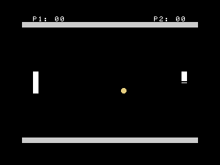

Pong
====

Classic Pong, built as a standalone ROM cartridge for the
[A.C. Wright 6502](https://github.com/acwright/6502-ACE) family of computer
systems, using the [6502-CRT](https://github.com/acwright/6502-CRT) template.



Boots directly from the cartridge: no BASIC, no loading screen. One player
against a CPU paddle, or two players locally. First to 11 wins.

## Controls

Joystick primary, keyboard fallback. Player 1 defaults to joystick 1, with
WASD as a fallback; player 2 defaults to joystick 2, with the arrow keys
as a fallback. Whichever joystick is being touched wins outright each
poll; the keyboard only takes over when that player's joystick shows
nothing. A cartridge owns the whole shell while it runs, so unlike a
full-system BASIC prompt, keyboard input here can't collide with anything
else, which is why (unlike the sibling Snake cartridge) Pong supports it.

- **Up/Down** (joystick) or **W/S and Up/Down arrows** (keyboard): move
  your paddle
- **A button** (joystick) or **Space** (keyboard): on the title screen,
  confirms the highlighted mode; during play, pauses/resumes; after a
  game, returns to the title screen

On the title screen, up always highlights ONE PLAYER and down always
highlights TWO PLAYERS. In one-player mode, joystick 2 is also accepted
for player 1, so a single controller works from either port. In
two-player mode, joystick 1 drives the left paddle and joystick 2 drives
the right paddle, kept strictly separate.

Keyboard fallback follows the same split during gameplay: WASD only ever
moves player 1's paddle, the arrow keys only ever move player 2's, so one
player's keypresses can never reach the other's paddle. This matches the
standard convention for two people sharing one keyboard: WASD is the
physical left-hand cluster, arrow keys are the physical right-hand
cluster. In one-player mode the arrow keys are inert, since player 2 is
the CPU there, not a fallback target. Because the keyboard delivers
discrete keypresses rather than a live "held" state, a short hold-decay
window keeps a recently-pressed direction feeling held for a few ticks
after the last keypress, rather than stopping the paddle dead the instant
Chrin's buffer runs dry.

## Building

Requires [cc65](https://github.com/cc65/cc65) (`brew install cc65` on macOS):

```bash
make
```

Produces `Pong.crt`, a 32 KB ROM image (`$8000-$FFFF`), ready to run in the
[6502-EMULATOR](https://github.com/acwright/6502-EMULATOR) or burn to a
28C256/27C256 EEPROM.

```bash
make run      # launch the emulator with Pong.crt loaded
make eeprom   # burn to an AT28C256 via a TL866 programmer + minipro
```

## How it's built

- **Graphics:** TMS9918 Graphics I mode (32×24 cells), with custom 8×8
  tiles for the paddle, ball, wall, and overlay frame; see `src/tiles.asm`.
  The Kernal's `InitVideo` is used once at boot purely for its side effect
  of loading the CP437 font into VRAM, then the VDP is reprogrammed
  directly for Graphics I (`src/vdp.asm`). HUD text and the title/game-over
  screens reuse the surviving CP437 letter/digit glyphs via direct
  name-table pokes, since the Kernal's text routines assume its own
  40-column layout. Every multi-byte VDP register/address write is wrapped
  in `PHP`/`SEI`/`PLP`, since the VDP is itself an IRQ source and its own
  status read resets the same two-byte write latch our own writes depend
  on. An interrupt landing mid-sequence happens routinely at real frame
  rates (though never in headless turbo-speed testing) and would otherwise
  scramble the screen.
- **Title screen:** a real up/down-navigable menu, not a key-select
  prompt. With only two options, the direction pressed is unambiguous
  about which one it picks, so a single `GAME_MODE` value doubles as the
  cursor position; a `>` is drawn beside whichever option it currently
  selects. Always a full `ClearScreen`/`DrawWalls` wipe and redraw before
  drawing anything else, since it's reached both at initial boot (over an
  already-blank screen) and after a game over (over a live win-overlay box
  and the final board state) — clearing only at one of those call sites
  would leave the other showing stale content underneath.
- **Gameplay:** `src/physics.asm`'s `Tick` moves both paddles, computes
  the ball's candidate next position, checks top/bottom wall bounce and
  paddle collision independently (so a ball can bounce off both in the
  same tick near a corner), then scores if neither check consumed the
  tick. A ball that reaches a paddle's column without landing on one of
  its four rows gets one more tick to visibly sail past the edge before
  the miss counts as a score, versus landing exactly on the column for a
  bounce. Hitting the paddle's top or bottom half angles the return
  up or down instead of always going flat back.
- **Speed:** each paddle hit escalates the tick rate slightly (floored at
  `MIN_DELAY`), reset back to the base rate on every new serve.
- **CPU opponent:** `CpuAI` in `src/physics.asm` steers toward the ball but
  only re-decides every other tick, half a human's effective reaction
  speed, which is what makes it beatable. Aligning to the ball's row
  exactly (rather than a tolerance band) would make it oscillate forever,
  since a decision that moves the paddle two rows every other tick can
  jump clean over a one-row-wide target — fixed with a three-row deadband
  around the target instead of exact equality.
- **Randomness:** an 8-bit Galois LFSR (`src/rng.asm`), seeded from
  reaction-time entropy while the title screen waits for a mode to be
  confirmed, plus the RTC clock if fitted. Used to pick each serve's
  starting angle.
- **Sound:** `src/sound.asm` triggers short `SidPlayNote`/`SidSilence`
  blips for paddle hits, wall bounces, and scoring; the win fanfare uses
  the blocking `Beep`, acceptable since it only ever fires once, at the
  end of a game.
- **Input:** `src/input.asm` composes 6502-Lib's shared `core/input.asm`
  primitives, joystick first with a keyboard fallback layered behind them.
  Two separate polling routines, since "combine the joysticks" (and
  "combine the keyboard") means different things in each context:
  `PollMenuInput` (title screen) ORs both joystick ports together and
  accepts WASD or arrow keys interchangeably, since no player has been
  assigned to one yet; `PollInput` (gameplay) keeps the joystick ports
  strictly separate in two-player mode, but ORs joystick 2 into player 1
  in one-player mode, so a single-player controller works from either
  port, while WASD and arrow keys stay strictly split to player 1 and
  player 2 respectively regardless of mode. Gameplay also layers a
  short per-player hold-decay counter on top of the shared keyboard
  primitive, since Pong's paddle (unlike Snake/LightCycles) stops moving
  the instant nothing is pressed, and Chrin only delivers discrete
  buffered keypresses, not a live "is this key down" state. Button naming
  (A/B/X/Y) follows this platform's own documented convention (its BASIC
  `JOY()` reference and assembly input guide), not the generic "fire" of
  Atari-style joysticks.

## Project layout

| File | Purpose |
|------|---------|
| `Pong.asm` | Cartridge entry point, main loop, CPU vectors |
| `src/zeropage.inc` | Zero-page variables and game constants |
| `src/tiles.asm` | Graphics I constants and custom 8×8 tile bitmaps |
| `src/vdp.asm` | TMS9918 register/VRAM primitives, Graphics I setup, walls |
| `src/rng.asm` | LFSR pseudo-random generator |
| `src/input.asm` | Joystick-only polling (title menu and gameplay) |
| `src/hud.asm` | Text/digit drawing primitives |
| `src/screens.asm` | Title/mode-select menu, new game/serve, win and pause UI |
| `src/physics.asm` | Paddle movement, ball movement/collision/scoring, CPU AI |
| `src/sound.asm` | Paddle/wall/score/win sound effects |
| `6502.inc` / `6502.cfg` | Vendored system include and linker config (unmodified) |

## Verification

Built and tested against the emulator's headless CLI and JSON-RPC debug
protocol (`6502 run --headless --debug`, `6502 dbg ...`): title screen and
menu navigation, mode selection, one- and two-player gameplay, wall and
paddle bounces, scoring both directions, win condition and the win overlay,
pause/resume, and the title screen correctly clearing when returning to it
after a game over were all exercised and confirmed there.

## License

The code is released under the MIT License, see [LICENSE](LICENSE).

The game's name, logo, and icons, and the original artwork and audio in this repository, are not covered by that license and remain all rights reserved. If you fork it, please give your version its own name and look.
